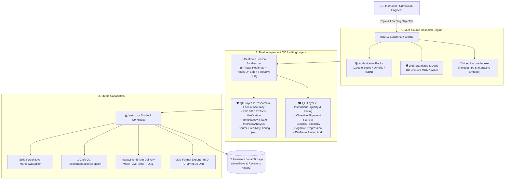

# LessonCraft AI: Autonomous 45-Minute Lesson Creation & Dual QC Studio

[](https://nodejs.org/)
[](https://react.dev/)
[](https://tailwindcss.com/)
[](https://github.com/Yashnaidu17/-AI-powered-Lesson-Creation-Tool-)
[](https://github.com/Yashnaidu17)

> **LessonCraft AI** is an autonomous curriculum engineering and validation studio that researches multi-source technical literature (books, RFC standards, and video instruction), synthesizes mathematically paced **45-minute educational lessons**, and rigorously validates the output through **two independent Quality Control (QC) auditing layers**.

---

## 🌟 Key Architecture & Capabilities



---

## 🎯 Core Features

### 1. Multi-Source Educational Research
- **Books:** Retrieves published textbooks with ISBNs, publishers, and publication years (e.g., Gourley & Totty's *HTTP: The Definitive Guide*, Richardson & Amundsen's *RESTful Web APIs*).
- **Official Standards & Documentation:** Queries authoritative specifications including IETF RFC 9110, MDN Web Docs, and W3C architecture references with source credibility grading.
- **Curated Video Lectures:** Recommends targeted educational videos with verified durations, channel provenance, and specific timestamp intervals for active revision.

### 2. 45-Minute Active-Learning Lesson Synthesizer
Strictly paced to maximize retention and cognitive engagement across five structured phases:
- **00:00 – 05:00 (5m):** Hook, Mental Model & Real-World Motivation (e.g., Restaurant Client-Server Analogy).
- **05:00 – 15:00 (10m):** Core Theoretical Foundations & Invariant Comparison Matrices.
- **15:00 – 25:00 (10m):** Deep Dive Mechanics, RFC Specifications & Concrete Code/Packet Inspections.
- **25:00 – 35:00 (10m):** Guided Hands-on Practical Lab Exercise & Troubleshooting Scenario.
- **35:00 – 45:00 (10m):** Formative Assessment, Retrieval Practice Quiz & Wrap-Up.

### 3. Dual Independent Quality Control (QC) Layers
- **QC Layer 1: Research and Factual Accuracy Auditor**
  - Cross-examines all technical assertions against official standards tracks (e.g. RFC 9110 §9.2.1 for Safe Methods, §9.2.2 for Idempotency).
  - Flags subtle misconceptions (e.g. distinguishing 401 Unauthorized [unauthenticated] from 403 Forbidden [authenticated but unauthorized]).
  - Provides a **1-Click "Apply Recommended Fix"** button that dynamically updates the lesson draft.
- **QC Layer 2: Instructional Quality & Pacing Auditor**
  - Measures learning objective alignment using a weighted sub-skill rubric.
  - Verifies that cognitive scaffolding bridges intuitive mental models before technical syntax.
  - Audits 45-minute time budget breakdown across phases.
  - Provides a **1-Click "Apply Enhancement"** button for immediate adoption.

### 4. Interactive Review, Edit & Delivery Studio
- **Split-Screen Live Editor:** Simultaneous editing with markdown rendering, live word count, and session duration projections.
- **Student Delivery Mode:** Integrated 45-minute countdown clock (Play / Pause / Reset), embedded YouTube players, and interactive diagnostic quiz runner with immediate pedagogical feedback.
- **Multi-Format Export:** One-click export to Markdown (`.md`), print-ready PDF-formatted HTML, and complete package JSON.
- **Resilient Offline Fallback:** Operates 100% offline out-of-the-box via built-in deterministic heuristic synthesis, while also offering plug-and-play support for Google Gemini and OpenAI models.

---

## ⚡ Quick Start

### Prerequisites
- [Node.js](https://nodejs.org/) v18+ (tested on Node.js v26)
- npm v9+

### 1. Installation
Clone the repository and install dependencies:
```bash
git clone https://github.com/Yashnaidu17/-AI-powered-Lesson-Creation-Tool-.git
cd -AI-powered-Lesson-Creation-Tool-

# Install backend dependencies
cd backend && npm install

# Install frontend dependencies and build assets
cd ../frontend && npm install && npm run build
cd ..
```

### 2. Launch the Application
```bash
npm start
```
Open your browser and navigate to:
👉 **[http://localhost:5000](http://localhost:5000)**

### 3. Run Automated Pipeline Tests
To execute the automated end-to-end verification suite:
```bash
npm test
```

---

## 🧪 Benchmark Curriculum Presets

The studio comes pre-loaded with comprehensive curriculum benchmarks:

1. **HTTP Requests and Responses:**
   - *Objective:* Explain GET and POST methods and distinguish between 2xx, 4xx, and 5xx response status categories.
   - *Evaluates:* RFC 9110 method semantics (safe vs idempotent), payload transfer mechanisms, status code taxonomy, and diagnostic fetch labs.
2. **Git Branching and Merge Conflict Resolution:**
   - *Objective:* Master branch pointers, 3-way merge algorithms, and systematically resolve conflict markers without code regression.
   - *Evaluates:* VCS state transitions, conflict anatomy, and active terminal troubleshooting exercises.
3. **Relational Database Indexing with B-Trees:**
   - *Objective:* Understand how B-Tree indices accelerate SELECT lookups from O(N) to O(log N) and identify write-overhead tradeoffs.
   - *Evaluates:* Systems architecture principles, algorithmic complexity, and index maintenance tradeoffs.

---

## 📁 Repository Structure

```
├── backend/
│   ├── data/
│   │   └── lessons.json           # Persistent storage for lessons & QC audit reports
│   ├── services/
│   │   ├── researchService.js     # Multi-source research (Books, Web Docs, YouTube)
│   │   ├── lessonGenerator.js     # 45-Minute Lesson Synthesizer & Pacing
│   │   ├── qc1Service.js          # QC Layer 1: Research & Factual Accuracy Auditor
│   │   ├── qc2Service.js          # QC Layer 2: Instructional Quality Auditor
│   │   ├── llmService.js          # Gemini / OpenAI API integration
│   │   └── storageService.js      # Autosave, revision history & persistence
│   ├── package.json
│   └── server.js                  # Express API & static frontend server
├── frontend/
│   ├── src/
│   │   ├── components/
│   │   │   ├── Header.jsx         # Navigation branding & controls
│   │   │   ├── InputSection.jsx   # Title/Objective input & benchmark presets
│   │   │   ├── PipelineTracker.jsx# Visual pipeline tracker with modular step retries
│   │   │   ├── LessonEditor.jsx   # Split-screen live Markdown editor
│   │   │   ├── QC1ReportView.jsx  # Factual accuracy inspector & 1-click fixes
│   │   │   ├── QC2ReportView.jsx  # Instructional quality & 45-min pacing inspector
│   │   │   ├── ResearchViewer.jsx # Books, Web Docs, and YouTube library
│   │   │   ├── StudentPreview.jsx # 45-Min countdown timer & interactive quiz
│   │   │   ├── ExportModal.jsx    # Multi-format export dialog (MD, PDF, JSON)
│   │   │   └── SettingsModal.jsx  # API key & offline engine configuration
│   │   ├── App.jsx                # Main application state orchestration
│   │   ├── index.css              # Custom styling & typography
│   │   └── main.jsx
│   ├── index.html
│   ├── package.json
│   ├── tailwind.config.js
│   └── vite.config.js
├── test_pipeline.js               # Automated end-to-end verification test suite
├── DEMO_GUIDE.md                  # Demonstration script & walkthrough
├── package.json                   # Root scripts
└── README.md                      # Comprehensive documentation
```

---

## 👨‍💻 Author

**Yash Naidu**  
- GitHub: [@Yashnaidu17](https://github.com/Yashnaidu17)  
- Repository: [https://github.com/Yashnaidu17/-AI-powered-Lesson-Creation-Tool-](https://github.com/Yashnaidu17/-AI-powered-Lesson-Creation-Tool-)

---
*Built with React, Node.js, Express, Tailwind CSS, and standards-compliant curriculum engineering algorithms.*
